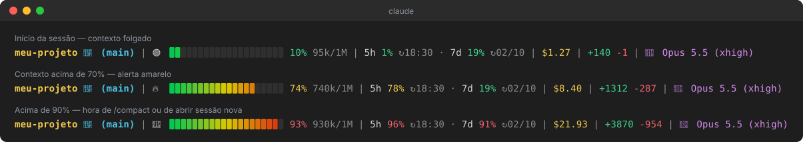
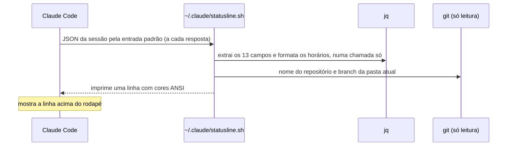

# statusbar-claude-schulze

Barra de status para o **Claude Code**, em uma linha: quanto do contexto já foi usado, quanto falta dos limites de 5 h e da semana (e quando eles zeram), custo da sessão, linhas alteradas e modelo em uso.

<p align="center">
  
</p>

<p align="center">
  <a href="#-instalar-em-1-minuto"><b>⚡ Instalar</b></a> ·
  <a href="#-o-que-cada-parte-mostra">🔎 Entender a barra</a> ·
  <a href="#-experimente-sem-instalar">🧪 Experimentar</a> ·
  <a href="#-não-funcionou">🩺 Problemas</a> ·
  <a href="#-personalizar">🎨 Personalizar</a> ·
  <a href="#-atualizar-ou-remover">🔄 Atualizar / remover</a>
</p>

---

## ⚡ Instalar em 1 minuto

### Passo 1 · Confira os requisitos

```bash
jq --version && git --version
```

Se os dois comandos mostrarem uma versão (o `jq` precisa ser 1.6 ou mais novo), siga para o passo 2. Se algum der `command not found`:

<details>
<summary><b>Como instalar o <code>jq</code> e o <code>git</code></b></summary>

<br>

| Sistema | Comando |
|---|---|
| Ubuntu / Debian | `sudo apt install -y jq git` |
| Fedora / RHEL | `sudo dnf install -y jq git` |
| macOS | `brew install jq git` |
| Windows (Git Bash) | `winget install jqlang.jq` (o git já vem com o Git Bash) |

O `git` é opcional: sem ele, só o nome do repositório e a branch deixam de aparecer.

</details>

<details>
<summary><b>Meu terminal serve?</b></summary>

<br>

A barra usa cor de 24 bits (truecolor) e emoji. Funcionam bem: terminal do VS Code / Cursor, Windows Terminal, iTerm2, Ghostty, WezTerm, Kitty, GNOME Terminal e Konsole.

- **Terminal.app** antigo do macOS não tem truecolor: o degradê sai com cores aproximadas.
- **tmux**: acrescente `set -as terminal-features ',*:RGB'` ao `~/.tmux.conf`.
- Testado em Linux com bash 5.3 e com bash 3.2 (o que vem no macOS), e com jq 1.6, 1.7 e 1.8. No Windows, só pelo Git Bash ou WSL, e ainda não foi testado.

</details>

### Passo 2 · Clone e instale

```bash
git clone https://github.com/SchulzeTecnologia/statusbar-claude-schulze.git
cd statusbar-claude-schulze
./install.sh
```

O instalador termina mostrando a barra com dados de exemplo:

```
instalado: /home/voce/.claude/statusline.sh
backup:    /home/voce/.claude/settings.json.bak-20261001-142530
settings:  /home/voce/.claude/settings.json

prévia (com dados de exemplo):
statusbar-claude-schulze 🌿 (main) | ⚡ █████████░░░░░░░░░░░ 47% 94k/1M | 5h 24% ↻18:30 · 7d 41% ↻02/10 | $0.47 | +156 -23 | 🤖 Opus 5.5 (xhigh)

a barra aparece na próxima resposta do Claude Code
```

### Passo 3 · Pronto

Abra o Claude Code (ou continue numa sessão aberta) e mande qualquer mensagem: a barra aparece depois da resposta. Não precisa reiniciar.

> [!TIP]
> A barra vale para **todas** as sessões do Claude Code desse usuário nessa máquina, em qualquer pasta.

<details>
<summary><b>🤖 Prefere que o próprio Claude Code instale?</b></summary>

<br>

Cole isto numa sessão do Claude Code:

```text
Clone https://github.com/SchulzeTecnologia/statusbar-claude-schulze.git numa pasta temporária,
leia o install.sh e o statusline.sh, me diga em poucas linhas o que eles fazem e, se estiver tudo certo,
rode o install.sh e me mostre a saída.
```

Conforme o modo de permissão, o Claude pede autorização antes de rodar cada comando.

</details>

<details>
<summary><b>🔧 Instalação manual, sem o <code>install.sh</code></b></summary>

<br>

1. Copie o script:

   ```bash
   mkdir -p ~/.claude
   cp statusline.sh ~/.claude/statusline.sh
   chmod +x ~/.claude/statusline.sh
   ```

2. Abra `~/.claude/settings.json` (crie se não existir) e acrescente a chave `statusLine`, sem apagar as outras:

   ```json
   {
     "statusLine": {
       "type": "command",
       "command": "bash ~/.claude/statusline.sh",
       "padding": 0
     }
   }
   ```

</details>

<details>
<summary><b>O que o <code>install.sh</code> altera na máquina?</b></summary>

<br>

Só duas coisas, ambas dentro de `~/.claude/`:

| Arquivo | O que acontece | Backup |
|---|---|---|
| `~/.claude/statusline.sh` | É criado ou substituído | Se já existia um script que **não** é desta barra: `statusline.sh.bak-AAAAMMDD-HHMMSS` |
| `~/.claude/settings.json` | Ganha a chave `statusLine`. As demais chaves não mudam | Sempre que o arquivo muda: `settings.json.bak-AAAAMMDD-HHMMSS` |

- Os backups levam data e hora no nome, então rodar o instalador várias vezes nunca apaga um backup anterior.
- Se o `settings.json` já está configurado, ele não é regravado.
- Se você já tinha outra barra de status, o instalador avisa antes de substituir e a configuração anterior fica no backup.
- Antes de mexer em qualquer arquivo, o instalador confere a versão do `jq`, se o `settings.json` é um JSON válido e se há permissão de escrita. Se algo falhar, para sem alterar nada.
- O script é trocado de forma atômica (cópia temporária + renomear), para nenhuma sessão aberta do Claude Code ler um arquivo pela metade.
- `./install.sh --remover` só apaga o `statusline.sh` se ele for desta barra.

</details>

---

## 🔎 O que cada parte mostra

```
meu-projeto 🌿 (main) | 🟢 ██░░░░░░░░░░░░░░░░░░ 10% 95k/1M | 5h 1% ↻18:30 · 7d 19% ↻02/10 | $1.27 | +140 -1 | 🤖 Opus 5.5 (xhigh)
```

| Parte | O que significa |
|---|---|
| `meu-projeto` | Nome do repositório git da pasta onde o Claude Code está aberto |
| `🌿 (main)` | Branch atual |
| `██░░░ 10%` | Quanto da janela de contexto já foi usado. A barra vai de verde a vermelho conforme enche |
| `95k/1M` | Tokens no contexto / tamanho da janela (200k ou 1M, conforme o modelo) |
| `5h 1% ↻18:30` | Uso do limite de 5 horas e o horário em que ele zera |
| `7d 19% ↻02/10` | Uso do limite semanal e o dia em que ele zera (no próprio dia, mostra o horário) |
| `$1.27` | Custo estimado da sessão **a preço de API**. Nos planos Pro/Max não é cobrado; serve só de referência |
| `+140 -1` | Linhas adicionadas / removidas na sessão |
| `🤖 Opus 5.5 (xhigh)` | Modelo em uso e nível de effort (o effort some quando o modelo não tem) |

**Semáforo** — o emoji e a cor do percentual avisam quando agir:

| Contexto usado | Emoji | Cor do % | O que fazer |
|---|---|---|---|
| até 19% | 🟢 | verde | nada |
| 20% – 69% | ⚡ | verde | nada |
| 70% – 89% | 🔥 | amarelo | pensar em `/compact` antes de começar uma tarefa grande |
| 90% ou mais | 🚨 | vermelho | `/compact` ou `/clear` agora |

Os percentuais de 5h / 7d seguem as mesmas cores (verde < 70%, amarelo 70–89%, vermelho ≥ 90%).

> [!NOTE]
> Os limites de **5h / 7d** só aparecem em contas **Pro/Max**, e só depois da primeira resposta da sessão. Quem usa chave de API não vê essa parte. Os horários seguem o fuso da máquina.

<details>
<summary><b>Como funciona por baixo</b></summary>

<br>



Cada atualização leva cerca de 35 ms: o script abre só dois processos (um `jq` e um `git`) e faz o resto com comandos internos do bash. Não acessa a rede, não usa `eval`, não grava arquivos e não lê credenciais.

</details>

---

## 🧪 Experimente sem instalar

O Claude Code chama o script passando um JSON pela entrada padrão. Dá para simular qualquer cenário a partir do exemplo:

```bash
# como está no exemplo
bash statusline.sh < exemplos/entrada.json; echo

# contexto quase cheio (fica vermelho)
jq '.context_window.used_percentage = 95' exemplos/entrada.json | bash statusline.sh; echo

# conta com chave de API (sem limites 5h / 7d)
jq 'del(.rate_limits)' exemplos/entrada.json | bash statusline.sh; echo

# modelo sem effort
jq 'del(.effort) | .model.display_name = "Haiku 4.5"' exemplos/entrada.json | bash statusline.sh; echo
```

`exemplos/entrada-real.json` tem um JSON completo, capturado do Claude Code 2.1.283, com todos os campos disponíveis.

---

## 🩺 Não funcionou?

<details>
<summary><b>A barra não aparece</b></summary>

<br>

1. Ela só surge **depois da próxima resposta** do Claude. Mande uma mensagem qualquer.
2. Confira se o settings aponta para ela:
   ```bash
   jq '.statusLine' ~/.claude/settings.json
   ```
   Deve mostrar `"command": "bash ~/.claude/statusline.sh"`.
3. Rode o script na mão para ver se há erro:
   ```bash
   bash ~/.claude/statusline.sh < exemplos/entrada.json; echo
   ```
4. Abra com `claude --debug`: o log mostra a saída de erro do script.
5. Em máquinas da empresa com *managed settings*, `disableAllHooks` ou `allowManagedHooksOnly` desligam barras pessoais. Pergunte ao administrador.

</details>

<details>
<summary><b>O instalador falhou no <code>settings.json</code></b></summary>

<br>

A mensagem `não é um objeto JSON válido` quase sempre é vírgula sobrando ou comentário `//` no `settings.json`. O instalador para sem alterar nada. Para achar o erro:

```bash
jq . ~/.claude/settings.json
```

Corrija a linha indicada e rode `./install.sh` de novo.

</details>

<details>
<summary><b>Aparecem quadradinhos no lugar dos emojis ou dos blocos</b></summary>

<br>

A fonte do terminal não tem esses caracteres. Use uma fonte com emoji e caracteres de bloco: JetBrains Mono, Cascadia Code, Fira Code ou qualquer *Nerd Font*.

</details>

<details>
<summary><b>As cores do degradê estão estranhas</b></summary>

<br>

O terminal não tem truecolor. Veja a lista em [Meu terminal serve?](#passo-1--confira-os-requisitos). No tmux, acrescente `set -as terminal-features ',*:RGB'` ao `~/.tmux.conf` e reabra a sessão.

</details>

<details>
<summary><b>O horário de reset está errado (diferença de 3 horas)</b></summary>

<br>

A máquina, ou o container, está em UTC. Acrescente esta linha ao `~/.bashrc` (ou `~/.zshrc` no macOS) e abra de novo o terminal e o Claude Code:

```bash
export TZ=America/Sao_Paulo
```

</details>

<details>
<summary><b>Os limites 5h / 7d não aparecem</b></summary>

<br>

É esperado quando:

- a conta usa **chave de API** (só Pro/Max recebem esses dados);
- a sessão acabou de abrir e **ainda não houve resposta**;
- a janela já zerou e o Claude Code ainda não recebeu os números novos.

</details>

---

## 🎨 Personalizar

Edite o `statusline.sh` **deste repositório**, confira com `testes/rodar.sh` e rode `./install.sh` de novo para aplicar. O script está dividido em blocos:

| Bloco | Para que serve |
|---|---|
| **Aparência** | Cores, separador, largura da barra, pontos do degradê (`DEGRADE`) e emojis por faixa de uso (`EMOJIS`). Para mudar o visual, quase sempre basta mexer aqui |
| **Funções** | `pct` (percentual colorido) e `abrevia` (94140 → 94k) |
| **Dados da sessão** | Um único `jq` lê todos os campos e já converte os horários de reset. Para usar um campo novo, acrescente-o na lista do `jq` **e** o nome da variável no `read`, na mesma posição |
| **Repositório e branch** | Um único `git` |
| **Contexto** | A barra em degradê, o emoji, o percentual e os tokens |
| **Limites de 5h / 7d** | Uso e horário de reset |
| **Custo, linhas e modelo** | Custo em dólar, linhas +/- e modelo com effort |
| **Linha final** | Junta as partes, deixando de fora as vazias. Para mudar a ordem ou retirar partes, é aqui |

<details>
<summary><b>Campos disponíveis e cuidados ao editar</b></summary>

<br>

Todos os campos que o Claude Code envia estão na [documentação oficial da status line](https://code.claude.com/docs/en/statusline), seção *Available data*, e `exemplos/entrada-real.json` mostra um JSON completo. Além dos usados aqui, há `session_name` (título automático da sessão), `workspace.repo`, `pr.number` / `pr.url`, `prompt_cache`, `fast_mode` e `thinking.enabled`.

- O script roda a cada resposta: evite comandos lentos ou que acessem a rede. Cada programa externo custa de 10 a 15 ms, e cada `$(...)` uns 2 ms. Para formatar texto, prefira `printf -v variavel ...`, que não abre processo.
- Mantenha compatível com o bash 3.2 (macOS): nada de `declare -A`, `mapfile`, `${var,,}` ou índices negativos.
- Use `git --no-optional-locks` para não travar o repositório enquanto o Claude trabalha nele.

**Testes.** `testes/rodar.sh` roda o script em 37 cenários (contexto em cada faixa, sem limites, repositório sem commits, HEAD solto, fora do git…) e compara a saída, byte a byte, com `testes/esperado.txt`. Se a mudança for proposital, rode `testes/rodar.sh --atualizar` e confira no `git diff` se o que mudou é o que você queria.

</details>

<details>
<summary><b>Estrutura do repositório</b></summary>

<br>

```
statusline.sh                          # o script da barra (é este que você edita)
install.sh                             # instala / remove no ~/.claude do usuário atual
docs/preview.svg                       # imagem do topo deste README
exemplos/entrada.json                  # JSON de exemplo para testar sem abrir o Claude Code
exemplos/entrada-real.json             # JSON real enviado pelo Claude Code 2.1.283 (conta Max), com o nome do projeto trocado
testes/rodar.sh                        # testes: compara a saída com testes/esperado.txt
testes/esperado.txt                    # saída esperada de cada cenário
LICENSE                                # licença MIT
```

</details>

---

## 🔄 Atualizar ou remover

**Atualizar** para a versão mais recente:

```bash
cd statusbar-claude-schulze && git pull && ./install.sh
```

**Remover**: desliga a barra e apaga o script (só se ele for desta barra). As outras configurações não mudam, e o `settings.json` ganha um backup antes.

```bash
./install.sh --remover
```

Outra forma é digitar `/statusline clear` dentro do Claude Code.

---

## Segurança

O script só lê o JSON que o Claude Code envia, consulta o git em modo somente leitura e imprime uma linha. Não acessa a rede, não usa `eval`, não grava arquivos e não lê credenciais.

Ele também se protege de dados inesperados:
- campos numéricos são validados antes de entrar em qualquer conta, e um campo com tipo errado vira vazio sem derrubar o resto da linha;
- caracteres de controle no nome do modelo, no effort, no repositório e na branch são removidos, para nenhum texto vindo de fora injetar sequências de escape no terminal.

O script e o instalador passam no [ShellCheck](https://www.shellcheck.net/) sem avisos.

## Licença

[MIT](LICENSE)
